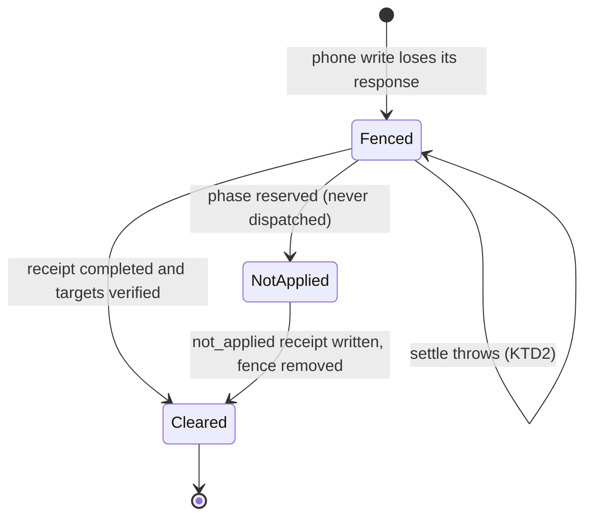
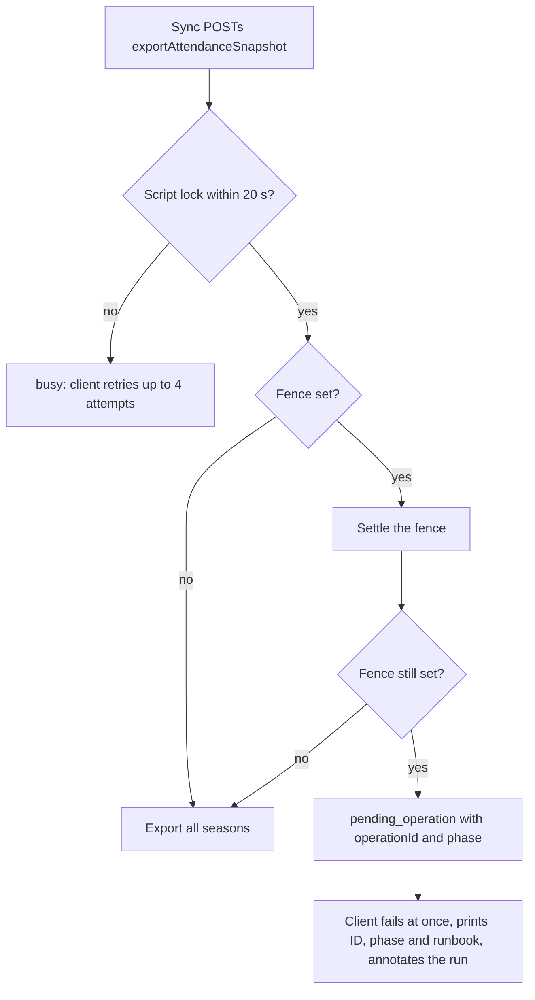

# Weekly Sync Pending Write Fence - Plan

## Goal Capsule

- **Objective:** The weekly dashboard sync succeeds whenever the sheet's last phone write can be verified. When it cannot, the failed run names the stuck write and the runbook, so Colin can act without reading logs line by line.
- **Means:** The server settles another client's pending write before it decides (KTD1), and the export, client and CI report a pending write by its own code (KTD3, KTD4, KTD5).
- **Authority:** This plan's requirements, then the fence rule in `docs/plans/2026-09-16-1450-feat-shared-guest-attendance-plan.md` (an uncertain write fences all writes and exports until its result is established). This plan never weakens that rule.
- **Stop conditions:** Stop and ask if settling would need to replay a write batch, clear a fence without verification, or change the iOS app.
- **Execution profile:** One agent in this worktree. The Apps Script deploy is Colin's step (KTD6).

## Product Contract

### Summary

The Apps Script route will settle a pending write left by another client before it refuses a request, using the existing verification that `getOperationStatus` runs for the owning phone. Only a truly uncertain write still blocks. The export, the sync script and the GitHub run will name that write, its phase and the runbook.

### Problem Frame

Weekly Data Sync failed on 22 Nov 2026 (run 45047982099) and again on a manual rerun (run 45082397391) with `Attendance snapshot unavailable (busy). No data changed.`
The export answers `busy` for two different causes: the script lock, and the `FCTC_PENDING_OPERATION` fence that a v2 phone write leaves when its response is lost.
Timing proved the fence: four attempts took 16 s, and a lock timeout alone takes 20 s per attempt.

Only the phone that made the write clears its fence, because a phone polls `getOperationStatus` only for its own outbox rows.
If that phone is closed, reinstalled, or its row is gone, the fence stays, and the weekly sync and every other phone's writes stay blocked.
The server already holds everything it needs to verify the write (journal, receipt, exact targets), but nothing asks it to.

Diagnosis took timing arithmetic because the CI log shows one word, `busy`, for both causes, and the client retries a fence for about 7 s, which cannot help.

### Requirements

**Sync resilience**

- R1. A pending write that the server can verify as completed, or prove was never dispatched, no longer blocks the export, other clients' writes, or state reads.
- R2. A pending write whose outcome stays uncertain keeps every write and the export fenced, as the shared-guest plan requires.
- R3. A failed fence check keeps the fence and never breaks a state read.

**Diagnosis**

- R4. The export reports a pending write with its own code, the operation ID and the journal phase. `busy` means only the script lock.
- R5. The sync script does not retry a pending-write refusal. Its failure line names the code, the operation ID, the phase and the runbook path.
- R6. In GitHub Actions, the failure appears as an error annotation that carries the same line.
- R7. A runbook maps each sync failure code to its fix, including how to rerun with milestone delivery.

**Safety**

- R8. Logs never contain the secret, a remote message, or a name: only allowlisted codes, a validated UUID and an allowlisted phase.

### Success Criteria

- The 22 Nov case (an applied write whose response was lost, with no phone polling) gives a green sync on the next run.
- An uncertain write gives a red sync whose annotation names the operation ID, its phase and `docs/operators/weekly-data-sync.md`.

### Scope Boundaries

- No iOS change. Phones pick up a settled fence through their next state read.
- No replay of a stored write batch, and no change to the atomic write path in `guestExecutePlan_`.
- Considered, not built: a Monday retry schedule in the workflow. A retry cannot clear an uncertain fence, and R1 clears the rest. A second scheduled failure in a row would change this call.
- Considered, not built: a separate fence-inspection script. The failure line already carries the operation ID and phase (R5), and the existing operator procedure covers the uncertain case.

#### Deferred to Follow-Up Work

- Run the Vitest suite in CI for `scripts/` changes. `attendance-tests.yml` runs only the Apps Script tests today.

---

## Planning Contract

### Key Technical Decisions

- KTD1. **Settle a foreign fence in the shared locked route.** In `guestRoute_`, after the fence is read under the lock, any request whose `operationId` differs from the fence first runs the existing `guestReconcile_` for that fence, then re-reads it. This covers the export, writers, `getState` and `getOperationStatus` for another ID. Reconcile verifies saved targets and never replays a batch, which is exactly what the owning phone's status poll does. A fence in phase `preparing` stays fenced, because a partial reservation fails closed (`guestReserveJournal_`). Rejected: letting the export ignore the fence (breaks the shared-guest plan's rule that a promotion is never captured half-applied), and making phones poll foreign IDs (needs a TestFlight build on every phone).
- KTD2. **Fail closed when settling throws.** Catch any error from the settle step, log a warning with the operation ID only, and keep the fence. Without this, a receipt fault (for example duplicate receipt rows) would turn every `getState` into a conflict and stop the app from loading.
- KTD3. **Export code `pending_operation`.** The export returns `pending_operation` with `operationId` and `phase` (`preparing`, `reserved`, `dispatching`, or null when no journal exists). `busy` stays for the lock timeout in `withLock_`. One helper builds this response for both the route check and the defensive check in `guestExportSnapshot_`.
- KTD4. **Client treats `pending_operation` as terminal.** The sync script prints the code, a UUID-validated operation ID, an allowlisted phase and the runbook path, and prints `unknown` for any field that fails validation. `busy` keeps its four-attempt retry. Unknown codes stay `service_error`.
- KTD5. **Annotation from the script, not the workflow.** When `GITHUB_ACTIONS` is `true`, the script writes the failure as `::error title=Attendance sync failed::<line>`, with `%`, CR and LF escaped. This keeps the workflow file unchanged and testable logic in one place.
- KTD6. **Deploy the client first.** Merge the client change, then `clasp push` and `clasp deploy -i <existing deployment id>`. The new client handles the old server's `busy` as before. The old client would print `service_error` for the new code.

### High-Level Technical Design

Fence outcomes when any request settles a foreign fence (KTD1). Only the uncertain outcome keeps blocking.

How the export answers after this change (KTD3, KTD4).

### Assumptions

- Settling inside `getState` is acceptable even though it can write one `not_applied` receipt for a never-dispatched write. This is the same write `getOperationStatus` already makes.
- A phone whose write another client settled reads the same `completed` or `not_applied` receipt on its next status poll, through the existing receipt path, so no app change is needed.
- The extra reads happen only while a fence exists, so normal request cost does not change.
- The runbook lives at `docs/operators/weekly-data-sync.md`, next to the existing operator docs.

---

## Implementation Units

### U1. Settle foreign fences and report pending writes distinctly

- **Goal:** The server clears every fence it can verify and reports the rest as `pending_operation`.
- **Requirements:** R1, R2, R3, R4, R8.
- **Dependencies:** None.
- **Files:** `apps-script/GuestActions.gs`, `apps-script/GuestOperations.gs`, `apps-script/AttendanceExport.gs`, `apps-script/test/guest-api.checks.js`, `apps-script/test/guest-promotion.checks.js`, `apps-script/test/export-snapshot.checks.js`.
- **Approach:**
  1. Add a settle helper next to `guestReconcile_` in `GuestOperations.gs` that runs it, catches any error (KTD2) and returns the fence that remains.
  2. Call it in `guestRoute_` right after the fence is read, only when the fence differs from `request.operationId` (KTD1).
  3. Replace the two export `busy` returns with one `pending_operation` helper in `AttendanceExport.gs` (KTD3).
- **Patterns to follow:** `errorResult` plus extra fields, as `guestPending_` adds `operationId`. Journal phase read through `scriptProperty_(GUEST_JOURNAL_PREFIX + 'PHASE')`.
- **Test scenarios:**
  - Applied write with lost response (`failMutationBatch(env, 'after')`): the next export from another client succeeds, `getState` shows `pendingOperationId` null, the owner's `getOperationStatus` returns `completed`, a replay returns the saved response, and the guest has one confirmed run. This rewrites the existing "lost applied response" test, whose fenced assertions this plan changes on purpose.
  - Never-dispatched reservation: an export from another client succeeds, and the owner's `getOperationStatus` then returns `not_applied`.
  - Uncertain dispatch (`failMutationBatch(env, 'before')`): the export returns `pending_operation` with the request's `operationId` and phase `dispatching`, writers still get `pending_verification`, and the grid is unchanged.
  - Lost promotion response: a second organiser's commit settles the fence and gets `guest_promoted`, not `pending_verification`, and the 2026 roster still holds one Rene. This rewrites one assertion in the existing "second organiser cannot repeat a transfer" test, whose no-double-transfer intent stays.
  - Fence in phase `preparing`: the export returns `pending_operation` with phase `preparing`, and the fence stays.
  - Fence property with no journal or receipt: the export returns `pending_operation` with phase null, and `getState` still answers with that `pendingOperationId`.
  - Settle error (a duplicated pending receipt row): `getState` returns its normal state with `pendingOperationId`, and the export returns `pending_operation`.
  - Lock held: the export still returns `busy`.
  - Existing tests for failed postcondition verification, setup response loss and lock ordering pass unchanged.
- **Verification:** The Apps Script suite passes with the rewritten and new scenarios.

### U2. Classify and report the failure in the sync script

- **Goal:** A pending-write refusal fails fast with a line that names the write and the runbook, also as a GitHub annotation.
- **Requirements:** R4, R5, R6, R8.
- **Dependencies:** None (compatible with the old server, KTD6).
- **Files:** `scripts/sync-attendance-snapshot.js`, `scripts/sync-attendance-snapshot.test.js`.
- **Approach:**
  1. Add `pending_operation` to the allowlisted reasons as a terminal error that carries the validated ID and phase (KTD4).
  2. Export a small formatter for the failure line and use it in the CLI entry (KTD5).
- **Patterns to follow:** The `it.each` terminal and transient tables in the existing test file, including the `private-test-secret` leak checks.
- **Test scenarios:**
  - `pending_operation` with a valid UUID and phase `dispatching`: one request, no delay, originals kept, and the message contains the code, the UUID, `dispatching` and `docs/operators/weekly-data-sync.md`.
  - `pending_operation` with `operationId: 'private-test-secret'` and an unknown phase: the message shows `unknown` for both and never the remote values.
  - `busy` still retries to four attempts (existing tables, unchanged).
  - Formatter in Actions: output starts with `::error title=Attendance sync failed::` and escapes `%`, CR and LF. Outside Actions it returns the plain line.
- **Verification:** The Vitest suite passes with the new scenarios.

### U3. Runbook and contract docs

- **Goal:** A failed sync points to one page that says what each code means and what to do.
- **Requirements:** R7.
- **Dependencies:** U1, U2 (the page documents their codes and output).
- **Files:** `docs/operators/weekly-data-sync.md`, `apps-script/README.md`, `docs/operators/manual-sheet-edits.md`.
- **Approach:**
  1. Write the runbook: a table of codes (`busy`, `pending_operation` for each phase including `preparing`, `bad_secret`, `snapshot_invalid`, `snapshot_too_large`, `shared_guests_disabled`, `service_error`, HTTP and non-JSON failures) with causes and fixes, plus the rerun-with-send command and the note that a scheduled rerun skips milestone delivery.
  2. Update the README's export and fence paragraphs to the new behavior and code, and link the runbook from the manual-edits recovery note.
- **Test expectation:** none -- documentation only.
- **Verification:** Every code the client can print appears in the runbook table.

---

## Verification Contract

| Gate | Command | Pass |
|---|---|---|
| Apps Script suite | `node --test test` in `apps-script/` | All pass (baseline 279 plus new) |
| Dashboard and script suite | `npx vitest run` at the repo root | All pass (baseline 511 plus new) |
| Live check (after Colin deploys) | Weekly Data Sync `workflow_dispatch` on `main` | Green, or red with a `pending_operation` annotation naming the ID |

## Definition of Done

- U1 to U3 are complete and both suites pass.
- No log line, test output or doc example contains a secret, a remote message or a name.
- The README, runbook and code agree on every code name.
- No experimental or abandoned code is left in the diff.
- The Apps Script deploy is handed to Colin with the exact steps (KTD6); it is not run without his approval.
