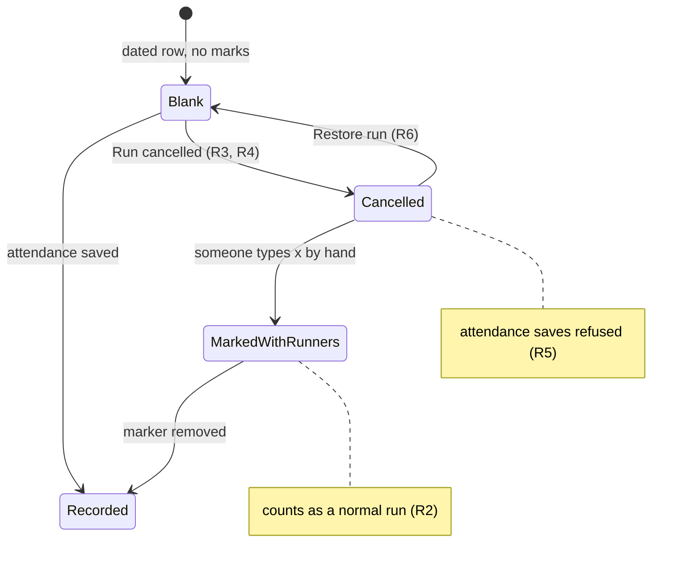
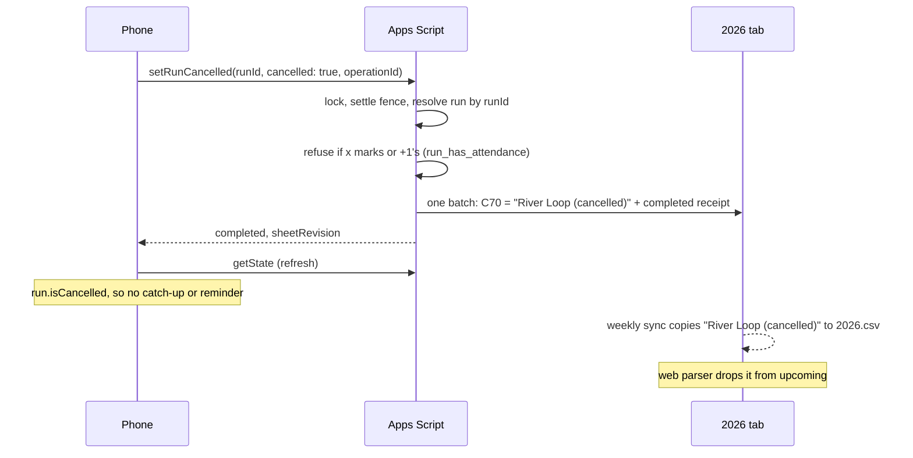

# Run Cancelled Action - Plan

## Goal Capsule

- **Objective:** An organiser marks a run that did not happen as cancelled in one tap. After that, no refreshed phone asks for its attendance or lists it as coming, and from the next weekly data sync the web dashboard never shows it as the next run. Club-day and streak numbers stay as they are everywhere.
- **Means:** A `(cancelled)` suffix in the sheet's Run cell, written by a new v2 Apps Script operation and read by every consumer through one shared rule (KTD1, KTD2).
- **Authority:** Aaron's request of 23 Nov 2026 and Colin's answers of the same day (Key Decisions). Where this plan and `docs/plans/2026-09-16-1450-feat-shared-guest-attendance-plan.md` meet, the shared-guest operation protocol governs.
- **Stop conditions:** Stop before any write path that could change attendance marks, `+1's`, distances or formulas. Stop if a live-sheet formula reads the Run column.
- **Execution profile:** Test-first in every layer. For the UI, build three working options and show simulator screenshots side by side before Colin picks one.
- **Ownership:** This session builds, tests and opens a PR from `claude/quizzical-greider-7e5bd7`. Colin approves the design, the merge, the Apps Script deploy and any TestFlight upload (build 20 or later).

---

## Product Contract

### Summary

Add **Run cancelled** to Review & Confirm for a run with no attendance, and **Restore run** for a cancelled one.
The server writes `River Loop (cancelled)` into the run's Run cell, or removes the suffix again.
Every reader of the sheet treats such a row as cancelled: it needs no attendance, it is not upcoming, and it is not a club day.

### Problem Frame

A run counts as recorded only when it has at least one attendee or +1 (`RunSnapshot.hasRecordedAttendance`).
A run that the club cancelled, or that nobody came to, stays unrecorded forever.
The app keeps offering it as needing attendance: in catch-up, as the default run, in reminders, and in the Past Runs list behind "Fill in a missed row".
Fri 8 May 2026 River Loop (2026 tab, row 70) is the live case.
On 23 Nov 2026, with Colin's go, its Run cell was set by hand to `River Loop (cancelled)` instead of deleting the row.
Deleting it would have broken the date chain (see Risks).

### Key Decisions

- **The marker is a `(cancelled)` suffix in the Run cell** (session-settled: user-directed — chosen over a `Cancelled:` prefix and over hidden row metadata: the Run cell is the only free-text cell no formula reads, people can see and type it, and the CSV sync already copies it). Governs R1, R2.
- **An organiser can restore a cancelled run from the app** (session-settled: user-directed — chosen over a sheet-edit-only undo). Governs R6.
- **Nobody may cancel a run that has attendance** (session-settled: user-directed — chosen over "anyone, and cancelling clears the marks", which would silently remove credit). Governs R4, R5.

### Requirements

**Sheet marker**

- R1. A run row is *marked* when its trimmed Run cell ends with `(cancelled)` or `(canceled)`, in any letter case, with optional space before the parenthesis. Its *label* is the text before the marker, trimmed.
- R2. A run is *cancelled* when it is marked and has no attendance: no member cell is `x` and `+1's` is 0. A marked row with attendance is a normal run under its label, so a hand-typed marker never removes credit.

**Cancel and restore**

- R3. Review & Confirm offers **Run cancelled** only for a run with no sheet attendance, no unsent or conflicted save on this phone, an empty draft, and a server that advertises the capability. A confirmation step precedes the write.
- R4. The server refuses to cancel a run that has attendance, and returns the fresh state.
- R5. The server refuses any attendance save to a cancelled run, from any app build, with a conflict that says to restore the run first.
- R6. A cancelled run opens to a cancelled state with **Restore run**. Restore removes the marker and the run becomes an ordinary unrecorded run.
- R7. Cancel and restore need a connection. They are never queued for later, and a lost response follows the operation-receipt check.

**Everyone who reads the sheet**

- R8. On iOS, a cancelled run leaves catch-up, the default run, run reminders, the "N past runs need attendance" count, both numbers of "N of M recorded", the Events tab's This week and Specials sections, and Home's This Week count. Home's today card shows it as cancelled, not open.
- R9. The run list shows a cancelled run with its label and a cancelled indicator, so it can still be opened and restored.
- R10. On the web dashboard, after the next Weekly Data Sync, a cancelled run never becomes the next run or an upcoming run, and its run id stays the id of its label.
- R11. Club days, streaks, Wall columns, totals and milestone inputs on iOS and the web are unchanged by a cancelled row. A test pins this.

### Acceptance Examples

- AE1. Covers R2, R11. Given Fri 8 May reads `River Loop (cancelled)` with no marks, when the 2026 season loads, then catch-up skips it, the web shows no run for it, and Aaron's streak and the club-day count are the same as before.
- AE2. Covers R3, R4. Given Colin's phone shows a blank run, and Aaron saves two runners on it first, when Colin confirms Run cancelled, then the server refuses, and Colin's screen shows the two runners.
- AE3. Covers R5, R6. Given a cancelled run, when a phone on build 19 sends attendance for it, then the server returns a `run_cancelled` conflict and writes nothing; after Restore run, the same save succeeds.
- AE4. Covers R2. Given someone types `x` for Dan on a marked row by hand, when the season loads, then the run counts as a normal River Loop with one runner everywhere.

### Scope Boundaries

- No sheet colour, legend or note changes. The sheet's existing "Attendance not recorded" legend is left alone.
- No change to guest, promotion or import flows, apart from the attendance refusal in R5.
- No offline queue for cancel or restore (R7).
- Not built: a per-person permission for cancelling. Every configured phone shares one secret, so the app has no organiser identity to check. Revisit if the club adds per-person setup codes.
- Not built: refusing a hand-typed marker in `addRun` labels. A new run typed with the marker is just a cancelled run; nothing breaks.
- Not built: a data sync triggered by a cancel. The web dashboard keeps its weekly snapshot, so a run cancelled in its own week can stay "next run" there until the following sync. Revisit if organisers rely on the web for the coming run.
- Not built: a milestone-email forecast change. The forecast counts every Mon, Wed and Fri of the target week and never reads scheduled rows, so a cancellation changes nothing there.

### Deferred to Follow-Up Work

- Release: Apps Script deploy (after a live-version diff) and TestFlight build 20, each on Colin's go.

---

## Planning Contract

### Key Technical Decisions

- KTD1. **One marker rule, three implementations, one fixture.** Apps Script (`apps-script/SheetOps.js`), the web (`src/utils/runLabels.js`) and Swift (`ios/FCTCAttendanceKit/ViewModels/RunLabel.swift`) each implement R1 and R2. A new shared fixture, `fixtures/attendance/run-cancellation.json`, lists raw cells with their expected label and marked flag. All three suites read it. This follows the repo's existing parity pattern: an expectation is written once in `fixtures/`, and the label rules are mirrored per stack.
- KTD2. **The wire keeps the raw Run cell.** `getState` and the export snapshot send the Run cell as typed, with the marker. Clients derive the cancelled state from the cell, so the read contract does not change. Old builds see `River Loop (cancelled)` as the label, which explains itself.
- KTD3. **A new v2 operation, `setRunCancelled`.** Fields: `spreadsheetId`, `seasonSheetId`, `runId`, `rowIndex`, `expectedDate`, `expectedRun`, `cancelled`. It goes through the existing journal, fence, receipt and verification path (`guestExecutePlan_`), with one cell target: the Run cell. It has no `baseRevision`: its only preconditions are run-local (R4), and a season-wide revision would refuse it after any unrelated edit. Repeating it is a completed no-op.
- KTD4. **Run identity ignores the marker.** `SheetOps.sameRunIdentity` compares labels with the marker removed. A queued save for `River Loop` then reaches the cancelled run and gets the specific `run_cancelled` conflict, not a generic `row_mismatch`.
- KTD5. **The capability flag gates the app.** `guestCapabilities_()` adds `runCancellation` (true when shared guests are enabled). Swift decodes it as optional, defaulting to false, so a phone talking to the version 6 server hides the button.
- KTD6. **One "needs attendance" predicate on iOS.** `RunSnapshot`, `ScheduledRun` and `RunRecord` gain `isCancelled` (R2) and `needsAttendance` (not recorded and not cancelled). Every prompt site in R8 switches from `!hasRecordedAttendance` to `needsAttendance`. The "N of M recorded" denominator, `EventsBoard` and Home's This Week count drop runs where `isCancelled` is true. `ClubRun.isRecorded` stays as it is, because a cancelled run already has no attendance (R11).
- KTD7. **The app follows the `addSharedRun` pattern for success, not for failure.** `SyncEngine.setRunCancelled` saves a `PendingGuestOperation`, drains, reads the completed response, then refreshes the season. After the drain it checks the row. A row that is not `.completed` or `.checking` (offline, refused, a conflict, behind another fence, or not yet sent by a drain already running) moves to `.superseded`, which the drain, Home and the Outbox already skip, and the engine throws the stored conflict or error. Only a `.checking` row (unknown delivery) stays for the receipt check. This is how R7 holds: a failed cancel never lands later.
- KTD8. **Narrow sheet-safety extension.** The v2 adapter may write the Run cell of an existing run row, only to add or remove the marker, and only when the cell is not a formula. The README's write-boundary text records this.

### High-Level Technical Design

A run row moves between four states. Only the app's two actions and hand edits move it.

### Assumptions

- Only the date chain, the `=AL*E` km column and the summary rows read run cells; no live formula reads column C. Checked on 23 Nov 2026 for the 2026 tab's summary rows and rows 69 and 70.
- Organisers update to build 20 before they rely on the button. Older builds keep working, but they still prompt for cancelled runs.
- A phone schedules its run reminders when it refreshes. A phone that has not refreshed since a cancel still fires the reminder it already scheduled. Tapping it opens the cancelled run, because the reminder route matches the label without the marker (U4).

### Sources

- Live 2026 tab, read on 23 Nov 2026: A71 `=A70+3` through A164, `AM69 =AL69*E69`, `F7 =sumif(F13:F175,"=x",$E$13:$E$175)`.
- `apps-script/GuestActions.gs` (`guestActionPlan_` for `addRun`), `apps-script/GuestOperations.gs` (`guestExecutePlan_`).
- `ios/FCTCAttendanceKit/Services/GuestOperationSync.swift` (`addSharedRun`).
- `docs/solutions/ui-bugs/filtered-query-froze-the-guest-detail-screen.md`: do not add a filtered `@Query` to the pushed checklist screen.

---

## Implementation Units

### U1. Apps Script: marker rule, `setRunCancelled`, attendance refusal

- **Goal:** The server can cancel and restore a run, and refuses attendance on a cancelled run.
- **Requirements:** R1, R2, R4, R5, R7; KTD1, KTD3, KTD4, KTD5, KTD8.
- **Dependencies:** None.
- **Files:** `fixtures/attendance/run-cancellation.json` (new), `apps-script/SheetOps.js`, `apps-script/GuestOps.js`, `apps-script/GuestActions.gs`, `apps-script/GuestStore.gs`, `apps-script/Code.gs`, `apps-script/test/sheetops.checks.js`, `apps-script/test/guest-api.checks.js`, `apps-script/README.md`.
- **Approach:**
  1. Add the marker parse and the cancelled-run test to `SheetOps`, exported through the namespace object.
  2. Strip the marker inside `sameRunIdentity`.
  3. Add `setRunCancelled` to `guestOperationFields` and to the route's shared action list.
  4. Plan it in `guestActionPlan_`: resolve by run identity, check date and label, refuse attendance or a formula cell, plan one cell, predict the response.
  5. Refuse a cancelled run in `guestAttendancePlan_` and in the legacy `submitAttendance_`.
  6. Advertise `runCancellation` in `guestCapabilities_`.
- **Execution note:** Write the fixture and the failing checks first.
- **Patterns to follow:** The `addRun` branch of `guestActionPlan_` and its checks in `apps-script/test/guest-api.checks.js`.
- **Test scenarios:**
  - Every fixture row parses to its expected label and marked flag.
  - A cancel on a blank shared run writes exactly `River Loop (cancelled)` to the Run cell and a completed receipt, and nothing else.
  - A restore writes back the label only.
  - A repeated cancel with the same operation ID replays its receipt; a cancel of an already-cancelled run with a new ID completes with no cell change.
  - A cancel on a run with one `x` or with `+1's` of 1 returns `run_has_attendance` with state and writes nothing.
  - A cancel whose Run cell holds a formula returns `unsafe_formula`.
  - Covers AE3. A v2 `submitAttendance` to a cancelled run returns `run_cancelled` and writes nothing; after restore, the same request succeeds.
  - A legacy `submitAttendance` to a cancelled run returns a `run_cancelled` conflict.
  - A queued save whose `expectedRun` is `River Loop` reaches `River Loop (cancelled)` and gets `run_cancelled`, not `row_mismatch`.
  - Covers AE4. A marked row with an `x` lists as a normal run and accepts attendance.
  - `getState` advertises `runCancellation: true` only when shared guests are enabled.
  - A cancel behind another client's pending fence returns `pending_verification` without writing.
- **Verification:** The Node suite passes, and the recorded writes stay inside the band plus the one Run cell.

### U2. Web dashboard: cancelled rows leave upcoming

- **Goal:** The dashboard never shows a cancelled run as next or upcoming.
- **Requirements:** R1, R2, R10, R11; KTD1, KTD2.
- **Dependencies:** U1 (fixture).
- **Files:** `src/utils/runLabels.js`, `src/utils/runLabels.test.js`, `src/utils/dataParser.js`, `src/utils/dataParser.test.js`, `README.md`.
- **Approach:** `parseRunLabel` strips the marker and reports it. The parser skips a cancelled row, so it never enters `unrecorded`. A marked row with attendance stays a run under its label. Run ids use the label without the marker.
- **Patterns to follow:** The footnote-marker strip in `runLabels.js` and the `upcoming` tests in `dataParser.test.js`.
- **Test scenarios:**
  - Every fixture row parses to its expected label and marked flag.
  - A cancelled next run is not `upcoming[0]`; the run after it is.
  - Covers AE1. With row 70 marked, Fri 8 May yields no run and no upcoming entry, and the 2026 runs, totals and club days equal those of the unmarked fixture.
  - Covers AE4. A marked row with one attendee is a run with type `River Loop`.
  - A cancelled row's neighbours keep their run ids.
- **Verification:** Vitest and the production build pass.

### U3. iOS Kit: cancelled state, prompts and the engine operation

- **Goal:** The app knows which runs are cancelled, stops prompting for them, and can cancel or restore one.
- **Requirements:** R1, R2, R3, R5, R7, R8, R11; KTD1, KTD5, KTD6, KTD7.
- **Dependencies:** U1 (contract and fixture).
- **Files:** `ios/FCTCAttendanceKit/ViewModels/RunLabel.swift`, `Models/Run.swift`, `ViewModels/AttendanceSnapshots.swift`, `Services/SheetDTO.swift`, `Models/SharedGuest.swift`, `Services/GuestJSON.swift`, `Services/GuestOperationSync.swift`, `Services/SyncTypes.swift`, `Services/SharedSyncTypes.swift`, `ViewModels/AttendanceInsights.swift`, `ViewModels/RunPickerViewModel.swift`, `Services/RunReminderService.swift`, `ViewModels/HomeViewModel.swift`, `ViewModels/EventsBoard.swift`, `ViewModels/ChecklistViewModel.swift`, `ViewModels/UserFacingError.swift`, all under `ios/FCTCAttendanceKit/`; tests in `ios/FCTCAttendanceKitTests/` (new `RunCancellationTests.swift`, plus `RoundTwoHelperTests.swift`, `RunPickerViewModelTests.swift`, `ClubDaysTests.swift`, `EventsBoardTests.swift`).
- **Approach:**
  1. `RunLabel` parses the marker; the three run types gain `isCancelled` and `needsAttendance` (KTD6).
  2. The R8 sites switch to `needsAttendance`; `EventsBoard` and `HomeViewModel.thisWeekCount` drop cancelled runs; `TodayRunStatus` gains `cancelled`.
  3. `GuestCapabilities.runCancellation` decodes as optional.
  4. `SharedGuestOperation` allows `setRunCancelled`; the engine method follows KTD7 and is on the engine protocol.
  5. `ChecklistViewModel` exposes whether cancel is available (R3) and the cancel and restore actions. It reads this phone's outbox from the submissions the view already queries.
  6. `UserFacingError` gives `run_cancelled` and `run_has_attendance` plain messages.
- **Execution note:** Test-first, starting with the fixture parse and the catch-up skip.
- **Patterns to follow:** `addSharedRun` in `GuestOperationSync.swift`; `CatchUpPlanner` tests in `RoundTwoHelperTests.swift`.
- **Test scenarios:**
  - Every fixture row parses to its expected label and marked flag.
  - Catch-up and `nextOlderUnrecorded` skip a cancelled past run.
  - `defaultRun` skips a cancelled due run and picks the older blank one.
  - The reminder service schedules nothing for a cancelled future run.
  - Today status is `cancelled` for a cancelled run today and `recorded` for a marked run with runners.
  - A cancelled club run this week is absent from the Events tab's This week, a cancelled Xmas race is absent from Specials, and Home's This Week count drops by one.
  - Covers AE1. Club days, streaks and the Wall are identical with and without the marker on a blank row.
  - Capabilities decode without `runCancellation` (version 6 server) as false.
  - Cancel availability is false for a run with attendance, a queued save, a non-empty draft, a missing capability, or a run already cancelled.
  - The engine sends `setRunCancelled` with the run identity and refreshes the season on completion.
  - An offline cancel, a busy refusal, a `run_has_attendance` conflict, a cancel behind another phone's fence, and a cancel made while a drain is running each throw and leave no queued, conflict or rejected guest operation (KTD7).
  - A failed cancel followed by an attendance save on the same run sends only the attendance.
  - A cancel whose delivery is unknown stays `.checking` and settles through its receipt.
  - A `run_has_attendance` conflict maps to a message that names the reason.
- **Verification:** The Kit test target passes after `xcodegen generate`, with a higher test count than before.

### U4. iOS UI: the button, the cancelled state, and three options

- **Goal:** Organisers can cancel and restore from Review & Confirm, and see cancelled runs clearly in the run list and on Home.
- **Requirements:** R3, R6, R8, R9; KTD6.
- **Dependencies:** U3.
- **Files:** `ios/FCTCAttendance/Views/ChecklistView.swift`, `ios/FCTCAttendance/Views/RunPickerView.swift`, `ios/FCTCAttendance/Views/HomeComponents.swift`, `ios/FCTCAttendance/Views/HomeView.swift`, `ios/FCTCAttendance/Views/RootTabView.swift`, `ios/FCTCAttendance/UITestSharedGuestAPI.swift`, `ios/FCTCAttendance/UITestSupport.swift`, new `ios/FCTCAttendanceUITests/RunCancellationUITests.swift`, gitignored `review/run-cancelled/index.html`.
- **Approach:**
  1. Build three working placements behind a UI-test-only launch flag: (a) a destructive row at the foot of the checklist, (b) a toolbar menu item, (c) a third action beside Import Poll and Dictate. The options differ only in placement; the behaviour below is shared.
  2. Capture simulator screenshots of each option and the shared run-list and Home states, at the default and one accessibility text size, and lay them side by side in the review page.
  3. After Colin picks, keep that option, delete the others and the flag.
  4. Any overlay inside a List row uses `ContainerRelativeShape`.
  5. The reminder route in `RootTabView` matches a run's label without the marker, so a reminder scheduled before a cancel opens the cancelled run.
- **Shared behaviour:**
  - The action is absent, not disabled, whenever R3 fails. A run with ticks in the draft or a save in the outbox has attendance on its way, so cancel does not apply.
  - The confirmation reads "Cancel this run?", names the run and date, and says that every organiser and the dashboard see it as cancelled and that Restore run undoes it. Its buttons are "Mark cancelled" (destructive) and "Keep run". Restore run has no confirmation, because it removes nothing.
  - The cancelled state replaces the km field, guests, roster, Import Poll and Dictate with one status block (label, date, "Cancelled", one line of explanation) and Restore run. Confirm is hidden.
  - After a cancel, the screen shows the cancelled state. When an older run still needs attendance, it offers the same next-run choice that follows a confirm. After a restore, the screen becomes the ordinary blank checklist.
  - While cancel or restore runs, its button is disabled and shows progress. A failure uses the same error alert as Confirm, with the `UserFacingError` message. A `run_has_attendance` refusal refreshes the screen, so the runners show (AE2).
  - The run list row and the Home today card say "Cancelled" in text, not colour alone, and their VoiceOver labels end with "Cancelled". The Home card's tap opens the cancelled state.
- **Patterns to follow:** The `-ui-shared-guests` fake and its UI tests; the recorded Today card in `HomeComponents.swift`.
- **Test scenarios:**
  - Covers AE2. Cancel on a blank shared run, confirm, and the run reads cancelled in the run list; catch-up no longer counts it.
  - Restore run on that run returns it to an ordinary blank run.
  - The button is absent on a run with attendance.
  - A reminder route for `River Loop` opens the run whose cell reads `River Loop (cancelled)`.
- **Verification:** The UI test passes on the iPhone 17 Pro simulator; the review page shows all three options; Colin's pick is the only one left in code.

### U5. Docs and operator notes

- **Goal:** Operators know how cancellation looks in the sheet and how to do it by hand.
- **Requirements:** R1, R2; KTD8.
- **Dependencies:** U1 to U4.
- **Files:** `docs/operators/manual-sheet-edits.md`, `apps-script/README.md`, `README.md`.
- **Approach:** Document the marker, the attendance-wins rule, the new operation and conflict codes, the write-boundary extension, and the date-chain warning: never delete a run row in a chained band.
- **Test expectation:** none, documentation only.
- **Verification:** The docs name the marker exactly as the fixture does.

---

## Risks & Dependencies

| Risk | Mitigation |
|---|---|
| Deleting a run row breaks the Date chain: from row 71 (Mon 11 May) to row 164 (Fri 11 Dec), every date is `=A<previous>+n`, so all later dates become `#REF!`. | U5 documents it in the manual-edits guide; the cancel action makes deletion unnecessary. |
| The server deploy and the app ship separately. | KTD5: the app hides the button until the server advertises it. Old builds get a conflict, never a silent write. |
| Build 19 users keep prompts for cancelled runs. | Release notes for build 20 tell organisers to update. |
| A cancel races another phone's save. | R4: the server checks attendance under the script lock and returns fresh state. |

---

## Verification Contract

| Gate | Command | Proves |
|---|---|---|
| Apps Script | `node --test apps-script/test` | U1 contract, write boundary, refusals |
| Web | `npm test` and `npm run build` | U2 parser and build |
| iOS Kit | `cd ios && xcodegen generate`, then `xcodebuild test -project FCTCAttendance.xcodeproj -scheme FCTCAttendance -destination 'platform=iOS Simulator,name=iPhone 17 Pro' -only-testing:FCTCAttendanceKitTests` | U3 rules and engine |
| iOS UI | the same command with `-only-testing:FCTCAttendanceUITests/RunCancellationUITests -collect-test-diagnostics never` | U4 flow |
| Design | `review/run-cancelled/index.html` with three options side by side | Colin's pick |

Gate every `test-without-building` run on a successful build; distrust an unchanged test count.

---

## Definition of Done

- R1 to R11 and AE1 to AE4 have passing tests in the layers above.
- Colin has chosen one UI option; the other two and their launch flag are deleted.
- No experimental code remains from the options round.
- A PR from `claude/quizzical-greider-7e5bd7`, rebased on `origin/main`, describes the deploy order and that nothing was deployed.
